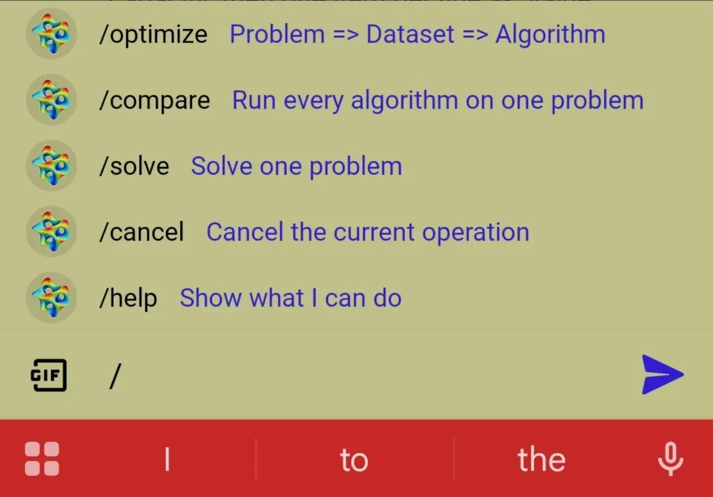
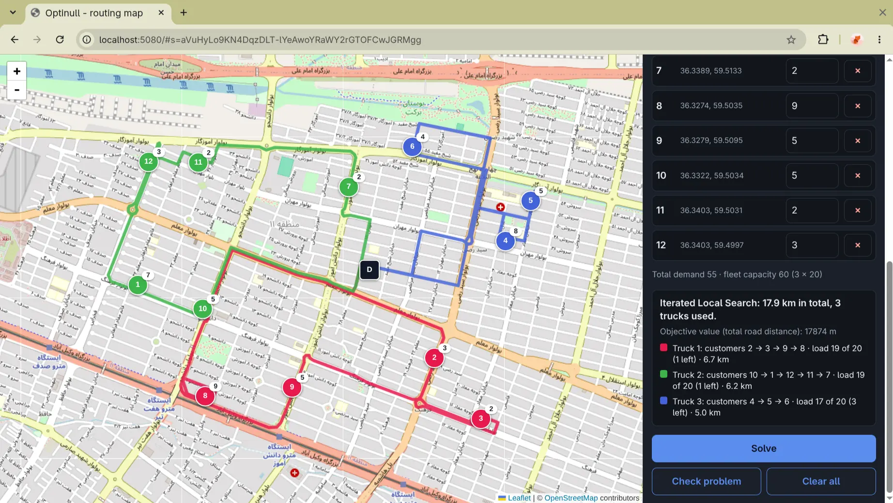
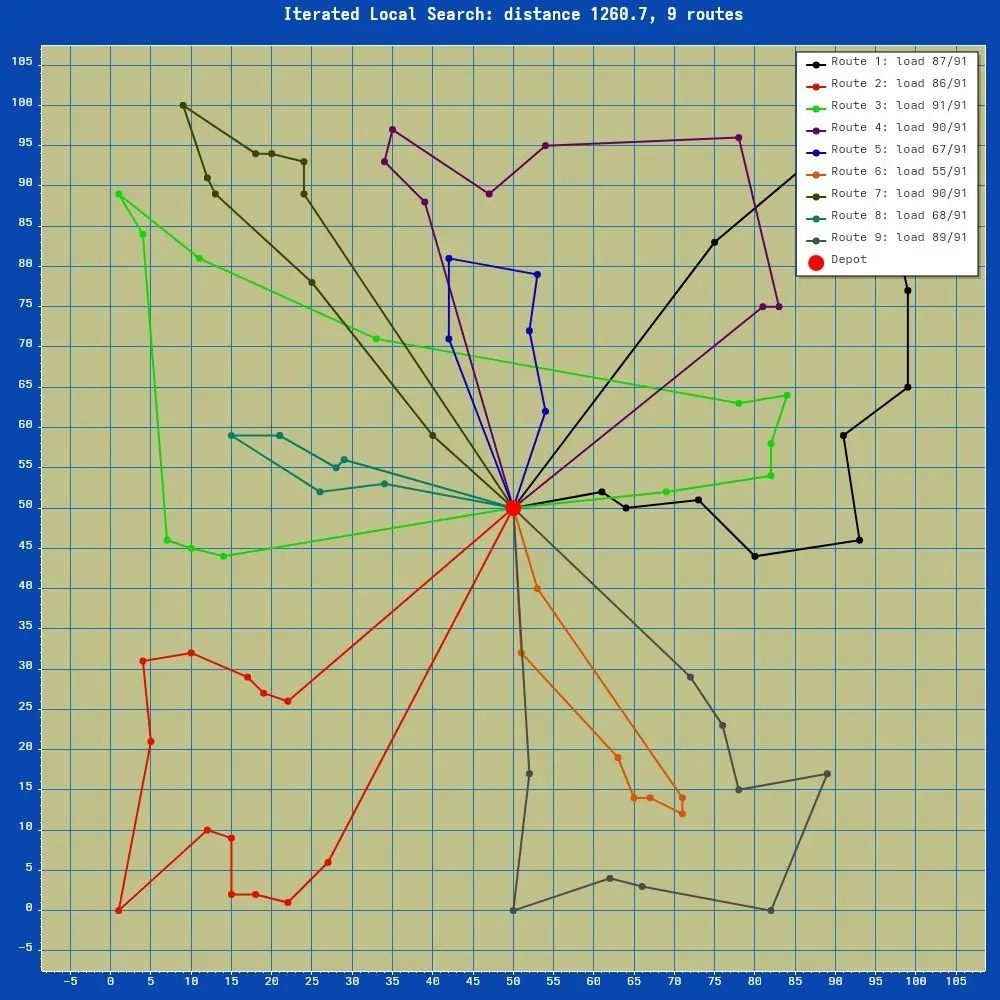
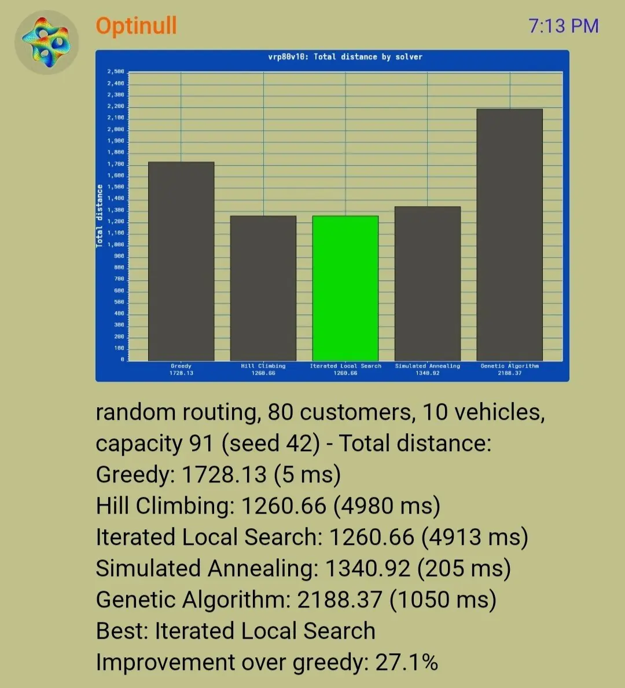
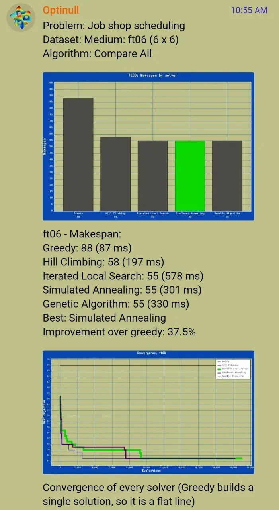
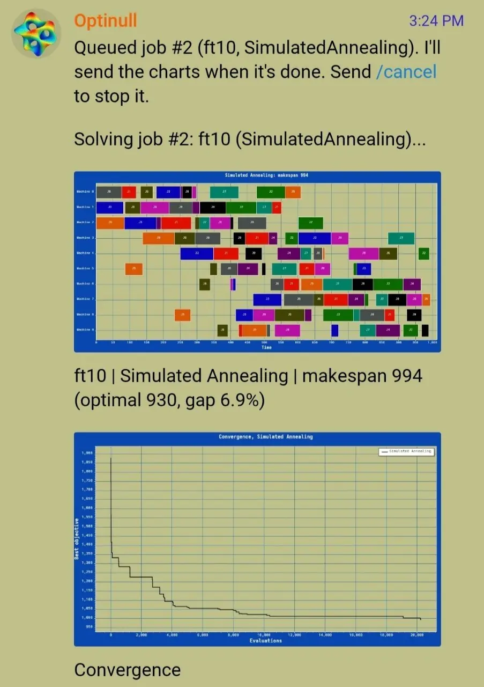

# Optinull Documentation

Optinull is a .NET 8 optimization engine controlled through a Telegram bot. This guide covers setup, commands, supported problem formats, solver tuning, architecture, testing, and extending the project.

[← Back to the project overview](../README.md)

## Contents

- [How it works](#how-it-works)
- [Requirements and setup](#requirements-and-setup)
- [Telegram commands](#telegram-commands)
- [Problem types and datasets](#problem-types-and-datasets)
- [Solver tuning](#solver-tuning)
- [Custom problem input](#custom-problem-input)
- [How results are reported](#how-results-are-reported)
- [Architecture](#architecture)
- [Adding a problem type](#adding-a-problem-type)
- [Testing](#testing)
- [Operational limits and current scope](#operational-limits-and-current-scope)
- [Roadmap](#roadmap)

## How it works

A user sends a command or follows the guided `/optimize` flow. Optinull resolves the requested problem instance, queues a job, runs the selected solver, and sends the result and relevant charts back to Telegram.

A comparison runs all five solvers against the same resolved instance. The same seed and evaluation budget are passed to the solvers, making the experiment more controlled and repeatable. This does not make stochastic algorithms universally comparable in every respect: elapsed time and evaluation counts can still differ, and a fixed seed does not imply identical behavior after code or runtime changes.

## Requirements and setup

### Requirements

- [.NET 8 SDK](https://dotnet.microsoft.com/download/dotnet/8.0)
- A Telegram bot token created with [@BotFather](https://t.me/BotFather)
- Network access to Telegram's Bot API

No database or public webhook endpoint is required by the current implementation.

### Clone and run locally

```bash
git clone https://github.com/Haflier/Optinull.git
cd Optinull

dotnet user-secrets set "Telegram:BotToken" "<your-telegram-bot-token>" \
  --project src/Optinull.Bot

dotnet run --project src/Optinull.Bot
```

Then open the bot in Telegram and send `/start`.

The application reads the token from configuration key `Telegram:BotToken`. For environment-based configuration, .NET maps double underscores to configuration separators:

```bash
export Telegram__BotToken="<your-telegram-bot-token>"
dotnet run --project src/Optinull.Bot
```

Do not commit bot tokens, local secret files, or real credentials.

### Run the tests

```bash
dotnet test
```

See [Testing](#testing) for running an individual test project.

## Telegram commands

### Commands at a glance

| Command | Purpose |
|---|---|
| `/start` | Show the welcome message and entry points |
| `/help` | List commands, algorithms, built-in datasets, tuning options, and custom-input formats |
| `/optimize` | Start the button-driven flow: choose a problem, dataset, and solver |
| `/solve <problem> ...` | Solve one instance with a selected solver |
| `/compare <problem> ...` | Run all five solvers on the same instance |
| `/cancel` | Cancel the current queued or running job for this chat |

### Command syntax

```text
/solve <problem-or-instance> [solver] [iterations=N] [seed=N] [setting=value ...] [problem-parameter=value ...]
/compare <problem-or-instance> [iterations=N] [seed=N] [setting=value ...] [problem-parameter=value ...]
```

Solver keywords:

- `greedy` — Greedy baseline
- `hc` — Hill Climbing
- `ils` — Iterated Local Search
- `sa` — Simulated Annealing; the default when no solver is specified
- `ga` — Genetic Algorithm
- `all` — run all five solvers; `/compare` is an equivalent explicit command

The problem argument can be a built-in instance name (`ft06`, `circle20`, `knap20`, `vrp15`, and so on) or a problem type (`jobshop`, `tsp`, `knapsack`, `vrp`). A problem type can be followed by custom instance text or by parameters to generate a random instance.

### Examples

```text
# Built-in job-shop benchmark; Simulated Annealing is the default
/solve ft06

# Explicit solver and evaluation budget
/solve ft10 ils iterations=50000 seed=42

# Reproducible random TSP instance
/solve tsp cities=30 sa seed=7

# Genetic Algorithm with custom settings
/solve knapsack items=50 ga population=100 mutation=0.3 iterations=20000

# Compare all solvers on a built-in instance
/compare ft10 iterations=50000

# The same comparison can be requested with "all"
/solve ft10 all iterations=50000

# Tuning settings are routed to their corresponding solver during comparison
/compare knapsack items=60 temperature=0.5 mutation=0.1
```

The parser accepts iteration aliases `iteration`, `iter`, and `it`. Tuning aliases are listed in [Solver tuning](#solver-tuning).

### Evaluation budget and seed

- `iterations` must be a whole number from **100 to 100,000**.
- If omitted, each solver uses its own default. Simulated Annealing and Genetic Algorithm use a default budget of **20,000** evaluations; Iterated Local Search also uses an evaluation limit.
- `seed` accepts a whole number. If omitted, the default seed is **42**.
- The same seed makes a run reproducible for a given implementation and environment. It should not be treated as a promise of bit-for-bit identical results across different versions or code changes.
- The `iterations` budget is most meaningful for the budgeted search algorithms (ILS, SA, and GA). Greedy and Hill Climbing have different stopping behavior.

## Problem types and datasets

| Problem id | Objective | Built-in instances | Random-instance parameters |
|---|---|---|---|
| `jobshop` | Minimize makespan | `ft06`, `ft10` | `jobs`, `machines` |
| `tsp` | Minimize tour length | `circle20`, `grid8`, `random50` | `cities` |
| `knapsack` | Maximize total value | `knap20`, `knap100` | `items` |
| `vrp` | Minimize total distance | `vrp15`, `vrp40` | `customers`, `vehicles` |

### Job Shop Scheduling

Each job consists of operations that must be processed in a specified order. Each operation names a machine and a processing time; operations on the same machine cannot overlap. The objective is to minimize the makespan, the time at which the final operation finishes.

Built-in benchmarks:

| Instance | Size | Known optimal makespan |
|---|---:|---:|
| `ft06` | 6 jobs × 6 machines | 55 |
| `ft10` | 10 jobs × 10 machines | 930 |

Generate a random instance:

```text
/solve jobshop jobs=6 machines=6 seed=42
```

The generated instance must satisfy the implementation's operation-count limit: `jobs × machines` cannot exceed 400. The parser also limits custom input to 20 jobs, 20 machines, 400 operations, processing times up to 100,000, and 20,000 characters.

### Traveling Salesman Problem (TSP)

Given a set of cities, find a short tour that visits every city and returns to the start. Optinull minimizes total Euclidean tour length.

Built-in instances:

- `circle20` — 20 cities on a circle
- `grid8` — an 8 × 8 grid of cities
- `random50` — a fixed 50-city instance

Generate a random instance:

```text
/solve tsp cities=30 seed=7
```

Custom input supports 3–200 cities. Coordinates must be finite numbers within ±1,000,000, and the input text is limited to 20,000 characters.

### 0/1 Knapsack

Each item has a value and weight. Choose a subset that maximizes total value without exceeding the capacity; each item is either selected or not selected.

Built-in instances:

- `knap20` — 20 items
- `knap100` — 100 items

Generate a random instance:

```text
/solve knapsack items=50 seed=42
```

Custom input supports up to 100 items, capacity up to 100,000, item values up to 100,000, and input text up to 20,000 characters. Capacity, values, and weights are whole numbers; weights must be positive.

### Vehicle Routing (VRP)

Capacitated vehicle routing with one depot. Vehicles start and end at the depot, every customer is served exactly once, and no vehicle carries more than its capacity. At most the given number of vehicles may be used (a vehicle may stay home). Optinull minimizes the total distance of all routes, using Euclidean distances.

Built-in instances:

- `vrp15` — 15 customers, 3 vehicles
- `vrp40` — 40 customers, 6 vehicles

Generate a random instance:

```text
/solve vrp customers=30 vehicles=5 seed=7
```

Customers lie in a 100 × 100 square around a central depot with demands from 1 to 20. The generator chooses a capacity that leaves the vehicles about 80% full on average, and raises it if the loads would not fit the fleet.

Every plan the solvers build and every move they make keeps the capacity and the fleet size, so a result is always a valid plan. Greedy is a nearest-neighbour heuristic with capacity. Hill Climbing, Iterated Local Search, and Simulated Annealing move a customer to any route (including an unused vehicle), swap two customers, or reverse a stretch of one route. The Genetic Algorithm recombines the customers' order and cuts it into routes again with the cheapest split that fits the fleet.

The loads must fit the fleet: custom input is rejected, naming the number of vehicles needed, when the vehicles cannot carry all demands (the check uses first-fit decreasing, which never needs fewer vehicles than a feasible plan, but can ask for one more than the true minimum). The parser limits custom input to 100 customers, 20 vehicles, capacity up to 100,000, coordinates within ±1,000,000, and 20,000 characters.

## Solver tuning

By default the engine chooses every solver setting for the problem and the evaluation budget, so a plain `/solve ft10 ga` needs no tuning. To change a setting, add it as a `key=value` token alongside `iterations`, `seed`, and problem parameters. Only the settings you give are overridden; everything you leave out stays automatic (see [Automatic settings](#automatic-settings)).

The value ranges are validated by the command parser. A tuning key belongs to one solver; for a single-solver command, specify that solver explicitly when required. With `/compare` or `all`, each setting is applied only to its corresponding solver.

### Settings reference

| Solver | Key | Alias | Range | Automatic value at 20,000 evaluations | Meaning |
|---|---|---|---:|---:|---|
| Simulated Annealing (`sa`) | `temperature` | `temp` | 0.01–100 | 1 | Multiplier for the problem's usual initial temperature |
| `sa` | `final` | `end` | 0.00000001–0.5 | 0.00001 | Final temperature as a fraction of the initial temperature |
| `sa` | `moves` | — | 1–10,000 | 90 | Moves tried at each temperature level |
| Genetic Algorithm (`ga`) | `population` | `pop` | 2–500 | 50; job shop 30 | Population size |
| `ga` | `mutation` | `mut` | 0–1 | 0.2 | Probability that a child is mutated |
| `ga` | `elite` | — | 0–100 | 2 | Number of best individuals retained unchanged; cannot exceed population |
| `ga` | `tournament` | — | 1–50 | 3 | Number of candidates in a parent-selection tournament; cannot exceed population |
| `ga` | `localsearch` | `ls` | 0–200 | 10; job shop 30 | Local-search attempts per child |
| Iterated Local Search (`ils`) | `perturbation` | `perturb` | 1–50 | 3 | Number of random moves used to perturb a solution between local-search phases |

The `elite` and `tournament` values must also be valid relative to `population`. For example, `population=10 tournament=20` is rejected even though both values individually fit their documented ranges. Because the automatic population depends on the problem and the budget, this combination check happens when the job starts, and the chat names the setting that is too large (for example `elite (40) cannot be more than population (30).`).

### Automatic settings

Every setting you do not give is chosen by the engine; every setting you do give is used exactly as given. The values in the table above are what the engine chooses at the default budget of 20,000 evaluations. They change with the problem and with `iterations`:

| Solver | What is automatic | Rule |
|---|---|---|
| `sa` | `moves` | The schedule keeps the shape of the default one (about 220 temperature levels) at any budget: `moves` is `iterations / 222`, between 5 and 1,000. A small budget gets few moves per level, a large one gets many. |
| `sa` | `temperature`, `final` | `temperature=1` is the problem's usual start (see [temperature scaling](#simulated-annealing-temperature-scaling)); `final` is 0.00001. |
| `ga` | `population` | Small enough to run at least about 20 generations within the budget (`iterations / (20 × (localsearch + 1))`), never above the problem's default (50, job shop 30) and never below 10. |
| `ga` | `elite`, `tournament` | `elite` is the larger of 2 and a twenty-fifth of the population; `tournament` is 3, or the population if that is smaller. |
| `ga` | `mutation`, `localsearch` | The problem's defaults: 0.2, and 10 (job shop 30). |
| `ils` | `perturbation` | About one random move per 20 parts of the problem (cities, items, operations, or customers), between 3 and 8. Instances up to about 60 parts keep 3. |

Greedy and Hill Climbing have no settings. A single run reports everything its solver used (see [How results are reported](#how-results-are-reported)), so you can see what the engine chose and copy it as a starting point for your own values.

These rules are reasoned defaults, not proven optima. The skipped sweeps in `tests/Optinull.Application.Tests/Tuning/SolverTuningExperiments.cs` print the mean result per problem for a range of values of one setting (the engine's current choice is the first row); use them to check a rule and change it where another value clearly wins on most problems.

### Simulated Annealing temperature scaling

The initial temperature is problem-dependent because TSP and routing distances, job-shop makespans, and knapsack values use different scales. `temperature=1` preserves the problem's usual initial temperature; `temperature=2` doubles it. This is a multiplier, not an absolute temperature.

For a custom cooling schedule, `moves` controls the number of moves tried per temperature level and `final` controls the ending temperature as a fraction of the start. The evaluation budget decides how long the run is: it holds `iterations / moves` temperature levels, so a custom `moves` never makes a run longer than the budget allows. Without `moves`, the engine picks it so that the run has about 220 levels.

Examples:

```text
/solve ft10 sa temperature=2
/solve ft10 sa temperature=2 final=0.001 moves=100
/solve tsp cities=50 ga population=100 mutation=0.3 iterations=20000
/solve ft10 ils perturbation=5 iterations=50000
```

A setting for the wrong solver is rejected. For example, `mutation=0.3` is a Genetic Algorithm setting, so use `ga` for a single-solver run or use it with `/compare`.

### Iterated Local Search budget note

ILS first performs a local climb before attempting perturb-and-restart cycles. If that first climb consumes the available evaluation budget, no restart may occur; in that case, changing `perturbation` has no practical effect. Increase `iterations` if you want to allow multiple climbs.

## Custom problem input

Custom instances can be sent as lines after the command or uploaded as a `.txt` file with the command as its caption. The input is parsed according to the selected problem type. Blank lines and lines beginning with `#` are ignored by the TSP, knapsack, and routing parsers; separators may include spaces, tabs, commas, or semicolons.

### Job shop format

The first line contains the number of jobs and machines. Each following line describes one job as `machine processing-time` pairs in operation order. Machine indices start at **0**.

```text
/solve jobshop sa
3 3
0 3 1 2 2 2
0 2 2 1 1 4
1 4 2 3 0 1
```

Here, the first job visits machine 0 for 3 time units, machine 1 for 2, then machine 2 for 2. Each job row must describe its operations in sequence.

### TSP format

Provide one city per line as `x y`. An optional leading ID is accepted and ignored. Decimal coordinates use a dot.

```text
/solve tsp hc
0 0
10 0
10 10
0 10
```

Equivalent comma- or semicolon-separated rows are accepted.

### Knapsack format

The first line is the positive integer capacity. Each following line contains one item as `value weight`.

```text
/solve knapsack ga
50
60 10
100 20
120 30
```

In this example, the solver chooses a subset whose total weight is at most 50 and whose total value is as large as possible.

### Vehicle routing format

The first line is `vehicles capacity`, the second line is the depot as `x y`, and every following line is one customer as `x y demand`. Demands are whole numbers from 1 up to the capacity; coordinates may be decimal (with a dot).

```text
/solve vrp ga
3 30
50 50
20 30 7
80 65 12
60 20 9
```

Here three vehicles of capacity 30 start at (50, 50) and serve three customers needing 7, 12, and 9 units.

### Uploading a text file

Attach a `.txt` file to a Telegram message and put the command in the caption, for example:

```text
/solve jobshop sa
```

Use the matching problem id (`jobshop`, `tsp`, `knapsack`, or `vrp`) and follow that problem's input format. The application also has a 30 KB file-attachment limit.

## How results are reported

A completed run can include:

- **Score:** makespan, tour length, total knapsack value, or total route distance, depending on the problem.
- **Improvement over greedy:** a relative comparison against the Greedy baseline when that comparison is defined.
- **Convergence chart:** how the recorded best score changed during search.
- **Problem-specific chart:** a Gantt chart for job shop, a route plot for TSP, selected/unselected items for knapsack, or one coloured route per vehicle (with its load) for vehicle routing.
- **Comparison summary:** relative solver results, elapsed time, evaluation count, and best-result/tie information.
- **Settings used:** a single run lists every setting its solver used, each marked `(auto)` when the engine chose it and `(yours)` when you set it, for example `Settings: population=22 (auto), elite=2 (auto), mutation=0.3 (yours), tournament=3 (auto), localsearch=10 (auto)`. Greedy and Hill Climbing have no settings to list.
- **Settings in a comparison:** the comparison summary lists only the settings you set, each tagged with the solver it was applied to, for example `Settings: temperature=2 (SA), mutation=0.3 (GA)`.

The objective direction differs by problem: lower is better for makespan, tour length, and total route distance; higher is better for knapsack value. Always compare scores within the same problem instance and objective.

## Architecture

Optinull uses a layered design. Telegram-specific code is kept at the edge; problem models and search algorithms are separated from command handling and reporting.

```text
Optinull.Bot
  ├── Optinull.Infrastructure       Telegram polling and replies
  └── Optinull.Application          Commands, dialogs, registry, queue, execution
        ├── Optinull.Problems        Job Shop, TSP, Knapsack, Vehicle Routing
        ├── Optinull.Optimization    Search algorithms and shared search abstractions
        ├── Optinull.Reporting       Chart rendering
        └── Optinull.Domain          Core optimization model
```

### Project responsibilities

| Project | Responsibility |
|---|---|
| `Optinull.Domain` | Optimization model: variables, expressions, constraints, objectives, solutions, and evaluation |
| `Optinull.Optimization` | Problem-independent search algorithms, neighborhoods, random solution generation, comparisons, and seeded randomness |
| `Optinull.Problems` | Concrete problem representations, evaluators, parsers, benchmark instances, random generators, and experiment support |
| `Optinull.Reporting` | PNG chart rendering for convergence, comparisons, schedules, routes, vehicle routes, and knapsack selections |
| `Optinull.Application` | Telegram command parsing, guided dialogs, problem registry, bounded job queue, job execution, and comparison orchestration |
| `Optinull.Infrastructure` | Telegram polling and sending text/photo replies |
| `Optinull.Bot` | .NET Worker Service host and dependency-injection composition root |

### Request lifecycle

1. `TelegramPoller` receives an update and passes the message to `BotCommandProcessor`.
2. `BotCommandParser` converts command text into a typed command and validates solver/tuning syntax.
3. `ProblemRegistry` resolves a built-in instance, generates a random instance, or parses custom input.
4. `JobQueue` accepts the job if the chat has no active job and the bounded queue has capacity.
5. `JobWorker` consumes queued jobs; `JobExecutor` runs the requested solver or comparison.
6. Progress and generated PNG reports are sent back through the Telegram reply abstraction.

The current queue and conversation state are in memory. They do not survive a process restart.

## Adding a problem type

Problem-specific behavior is exposed through `IProblemModule` and `IProblemInstance`, while search algorithms remain problem-agnostic where their abstractions allow it.

A practical implementation sequence is:

1. Add the problem model, validation, evaluator, and search-problem adapter in `Optinull.Problems`.
2. Add custom-input parsing and random-instance generation with explicit input limits.
3. Implement an `IProblemModule` in `Optinull.Application/Problems`. Define the module ID, title, built-in names, parameters, presets, parser, generator, and guided dialog.
4. Implement an `IProblemInstance` that invokes the appropriate solve service and maps outcomes to `SolverOutcome`/`SolveReport`.
5. Add the problem's report rendering and captions in `Optinull.Reporting` or the existing reporting service layer.
6. Register the module in `ProblemRegistry.CreateDefault()`.
7. Add unit tests for model invariants, parser validation, deterministic generation, solver behavior, and report integration.

Module IDs and built-in instance names must be unique; `ProblemRegistry` validates this at startup. The existing TSP module is a useful smaller example, while Job Shop illustrates a more involved scheduling problem.

## Testing

Run the complete suite from the repository root:

```bash
dotnet test
```

Run a specific project:

```bash
dotnet test tests/Optinull.Domain.Tests
dotnet test tests/Optinull.Optimization.Tests
dotnet test tests/Optinull.Problems.Tests
dotnet test tests/Optinull.Reporting.Tests
dotnet test tests/Optinull.Application.Tests
dotnet test tests/Optinull.Integration.Tests
```

The suite includes coverage for domain evaluation, search behavior and reproducibility, problem parsers and benchmarks, reporting, command parsing, tuning, job queue/executor behavior, and integration scenarios. A test passing does not establish that a heuristic always finds a known optimum; stochastic optimization should be evaluated across seeds and budgets when making performance claims.

### Tuning experiments

The automatic settings are checked by ordinary tests (the rules and the values at the default budget) and improved with manual experiments. `tests/Optinull.Application.Tests/Tuning/SolverTuningExperiments.cs` holds sweeps that are skipped by default. Remove the `Skip` of one and run it to print a table:

```bash
dotnet test tests/Optinull.Application.Tests --filter SolverTuningExperiments --logger "console;verbosity=detailed"
```

Each sweep runs one solver over 10 seeds on `ft06`, `ft10`, `random50`, `grid8`, and `knap100` for a list of values of one setting. The first row, `auto`, is the engine's current choice. Lower is better for the schedules and tours, higher is better for the knapsack. A sweep takes a minute or two, mostly on `ft10`.

## Operational limits and current scope

The current implementation is a single-process Telegram bot:

- **Job timeout:** 60 seconds per job.
- **Queue capacity:** 10 waiting jobs.
- **Worker concurrency:** 2 job workers.
- **Per-chat concurrency:** at most one active job per chat.
- **Input size:** uploaded text files are limited to 30 KB; parser-specific limits also apply.
- **State:** queue and guided-dialog state are in memory.
- **Execution model:** Telegram long polling; no public webhook is needed.

These are implementation defaults, not configurable deployment guarantees. Running multiple bot instances with the same Telegram token can cause polling conflicts; use a single active poller unless coordination is added.

## Screenshots

The screenshots below show Optinull's Telegram interface, optimization results, solver comparisons, and route visualizations.

<table>
  <tr>
    <td align="center"><br><sub>Telegram commands</sub></td>
    <td align="center"><br><sub>Map-based vehicle routing</sub></td>
  </tr>
  <tr>
    <td align="center"><br><sub>Vehicle routing</sub></td>
    <td align="center"><br><sub>Vehicle routing comparison</sub></td>
  </tr>
  <tr>
    <td align="center"><br><sub>TSP comparison and convergence</sub></td>
    <td align="center"><br><sub>TSP overview</sub></td>
  </tr>
</table>

## Roadmap

The README tracks these project-level next steps:

- [ ] Integration-test coverage improvements
- [ ] CI pipeline and container image
- [ ] Persistent job and conversation storage
- [ ] Additional problem types, such as bin packing
- [ ] Calibrate the automatic solver settings from the tuning sweeps

Already implemented:

- [x] Domain model with expression-based constraints and objectives
- [x] Greedy, Hill Climbing, Iterated Local Search, Simulated Annealing, and Genetic Algorithm
- [x] Job Shop, TSP, Knapsack, and Vehicle Routing with benchmarks, parsers, and random generators
- [x] Telegram `/optimize`, `/solve`, `/compare`, and `/cancel` flows
- [x] Convergence and problem-specific charts
- [x] Progress tracking, cancellation, time limits, and per-chat job limits
- [x] Solver tuning through chat parameters
- [x] Automatic per-problem and per-budget solver settings, with user overrides
